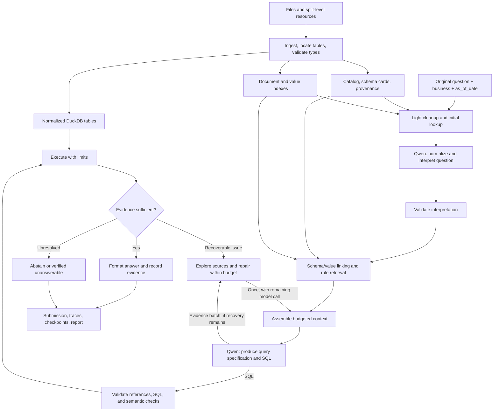

# DataMate Agent Design and Build Plan v2

The first milestone is an offline batch solver that produces scored answers for one development business. Use that run to measure where Qwen3.5-9B spends time and where the data pipeline loses information. The later gates cover additional evidence gathering and competition deployment. All performance targets below require measurement. [Original plan](datamate-agent-plan.md)

## 1. Task, data, and engineering principles

### Objective

Build an agent that answers natural-language questions using business data and accompanying documentation.

Target the DataMate batch submission. Defer interactive clarification and the MCP adapter until after G2 and only build them for a concrete client requirement.

The system must:

- Read CSV, XLSX, SQLite, Markdown, plain text, and basic JSON.
- Understand Vietnamese queries containing abbreviations, informal language, missing diacritics, spelling errors, and typing mistakes.
- Apply the correct business rules, dates, units, filters, and aggregation logic.
- Calculate numerical answers through executable queries.
- Preserve evidence connecting answers to their source data.
- Distinguish an answerable question from insufficient evidence or a processing failure.
- Run offline on Kaggle and through the final Docker entrypoint.

### Available data

The following inventory was verified in the local workspace:

| Component | Training split | Public test split |
|---|---:|---:|
| Businesses | 30 | 14 |
| Questions | 3,000 | 1,000 |
| XLSX files | 107 | 69 |
| Worksheets | 302 | 136 |
| Business CSV files | 20 | 10 |
| SQLite files | 1 | 1 |
| Reference answers | Available | Unavailable |

Each split also includes a rulebook and calendar. Each business has its own documentation and data files.

Important data characteristics:

- Worksheets may represent different tables or different months of the same table.
- Headers may begin below report titles and introductory text.
- Numeric and date columns may contain mixed physical representations.
- Rows may represent orders, order lines, payments, inventory snapshots, or reference mappings.
- Abbreviation mappings and business conventions may appear inside worksheets.
- Rules differ between splits.
- Relative dates depend on the question’s `as_of_date`.
- Missing data, empty results, zero values, and parsing failures have different meanings.

### Initial scope

Support structured tables and text documents. Defer PDF/DOCX extraction, OCR, macros, formula recalculation, fine-tuning, and multi-user web deployment.

For Excel formulas, use available cached values and record their presence. Missing cached results must be reported; the reader must not invent or silently recompute them.

“Production grade” in this plan means reliable offline batch execution: reproducible artifacts, bounded computation, validation, recovery, isolation, and observable failures.

### Code practices

Use a **functional core with explicit resource-owning objects**:

| Construct | Intended use |
|---|---|
| Pure functions | Normalization, parsing, scoring, formatting, context assembly |
| Typed records | Questions, schema cards, query interpretations, tool results, answers |
| Classes | Model runtime, database sessions, caches, process lifecycle |
| Interfaces/protocols | Replaceable model backends, retrievers, and execution adapters |

Additional conventions:

- Prefer composition and dependency injection.
- Keep notebooks thin; production logic belongs in the package.
- Validate configuration once at startup.
- Keep inference independent of reference answers and evaluation code.
- Use versioned prompts and explicit structured outputs.
- Preserve original data and record derived transformations.
- Avoid hidden global state and configuration read independently by many modules.
- Test behavior and failure boundaries rather than duplicating implementation details.

## 2. Model and system architecture

### Model decision

Use **`Qwen/Qwen3.5-9B` for both query understanding and SQL generation**.

Both stages reuse the same loaded model. Separate stages do not require separate model instances or additional model weights.

SQL-specialized models remain possible future experiments, but they are outside the initial implementation scope. Qwen is retained as the chosen model, not presented as a demonstrated winner over specialized models.

The model manifest must pin:

- Exact checkpoint revision.
- Tokenizer and chat-template revision.
- Serving configuration and dependency versions.
- Precision or quantization configuration.
- License and checkpoint publication evidence.
- Actual parameter accounting for the deployed configuration.

Keep normalization in non-thinking mode. At G2, compare SQL thinking enabled and disabled under the same checkpoint and question set. [Qwen model documentation](https://huggingface.co/Qwen/Qwen3.5-9B)

### Initial serving profile

Start with:

- vLLM, bound to localhost.
- Text-only loading.
- Two T4 GPUs with tensor parallelism.
- FP16.
- One concurrent sequence for the initial smoke test. Benchmark independent requests at concurrency 1, 2 and 4, then higher if memory permits.
- A configured context limit of 16,384 tokens.
- Explicit `enable_thinking=false` for the first smoke test.

This is a **profile to validate**, not a claim that the model has already passed on Kaggle. Text-only serving and the thinking switch are documented by vLLM; the exact checkpoint, kernels, GPU architecture, and installed stack still require a smoke test. [vLLM Qwen serving guidance](https://docs.vllm.ai/projects/recipes/en/latest/Qwen/Qwen3.5.html).

If the requested hardware is unavailable or the profile fails, stop with a clear environment report. Do not silently change the model, truncate prompts, or choose an untested quantization.

Validate the release image separately on two RTX 5090 GPUs with the competition CUDA requirement (≥12.8). Pin and record the driver, image, serving stack, precision and checkpoint for each target. Exercise offline loading, a representative long prompt, concurrent inference and a validated answer. If access is pending, proceed with development and record deployment as unverified until the image runs on equivalent hardware. [Competition hardware notes](../rules.md)

### Architecture



The controller owns budgets, validation, and state transitions. The model interprets language, proposes queries, and requests additional evidence through a restricted tool interface.

## 3. Data preparation and context engineering

### 3.1 Locate tables before interpreting column types

For each worksheet:

1. Inspect the first 50 rows for candidate header regions.
2. Evaluate candidates against up to 20 following rows.
3. If no credible region is found, expand the scan once to 200 rows.
4. Record a layout failure if the structure remains unresolved.

These are initial configuration values and must be evaluated on the development split.

Candidate evaluation considers:

- Header coverage and duplicate labels.
- Consistent row width below the header.
- Column-wise consistency in the following records.
- Merged cells and multi-row headers.
- Report titles, notes, repeated headers, and subtotal rows.

Preserve introductory text as document evidence. It may contain the reporting period, currency, or unit conventions.

Support multi-row headers by combining their labels while retaining source coordinates. Do not forward-fill arbitrary blank cells or assume that every row below a detected header is a transaction.

### 3.2 Preserve raw and normalized representations

Maintain three linked representations:

| Representation | Purpose |
|---|---|
| Original files and extracted cells | Preserve source evidence |
| Typed tables and logical views | Support reliable calculation |
| Catalog and profiles | Explain structure, meaning, and quality |

Record source file, worksheet/table, original row position, and transformation metadata.

Use source hashes and transformation versions to invalidate stale caches.

### 3.3 Normalize numbers and dates explicitly

Determine a parsing policy from the column’s values, source formatting, documentation, and semantic role.

For a source using comma thousands separators and decimal points:

| Original text | Parsed numeric value |
|---|---:|
| `15,000` | `15000` |
| `25,000.000` | `25000` |
| `25,000.125` | `25000.125` |

For a source using decimal commas, `15.000,50` instead represents `15000.50`.

Requirements:

- Preserve significant fractional values.
- Use decimal arithmetic for money.
- Preserve identifier strings and leading zeros.
- Handle date objects, documented date strings, and Excel serial dates with the workbook’s date system.
- Record ambiguous formats and failed conversions.
- Keep zero separate from blank, missing, and invalid values.
- Do not silently omit failed numeric conversions from aggregates.

LLMs may propose a column interpretation when documentation is ambiguous. Deterministic parsers perform the conversion and validate its consequences. Per-cell LLM rewriting is outside the initial design.

### 3.4 Identify row meaning and relationships

For every table, determine or explicitly mark as unresolved:

- What one row represents.
- Candidate keys and their uniqueness.
- Join relationships and expected cardinality.
- Order-level versus line-level amounts.
- Snapshot dates and data coverage.
- Units and conversion sources.

Create logical unions for monthly worksheets only when structural and semantic evidence supports combining them. Preserve all source-row references.

Retain empty tables in the catalog. A known empty table differs from an unreadable or absent table.

Load the split-level calendar alongside business tables. Keep its identity and scope explicit.

### 3.5 Build schema cards

Each card contains:

- Table identity and source references.
- Original column names and SQL identifiers.
- Physical and inferred semantic types.
- Row count, null count, distinct count, and relevant ranges.
- Representative values under size limits.
- Candidate keys, relationships, and grain.
- Documented units and definitions.
- Parsing and coverage warnings.
- Evidence references and provenance.

Separate measured facts, documented rules, and unverified hypotheses.

Derive profiles automatically from the mounted files and retain source coordinates for documented meanings. Treat model-proposed meanings as hypotheses until corroborated. Use measured properties and documented semantics for competition evidence pending written organizer clarification on derived profiles, indexes, normalized views and model annotations. Record the ruling before release and disable any disallowed artifact. [Competition data restrictions](../rules.md)

### 3.6 Use LLM-based query normalization

Normalization is an explicit Qwen call in the proposed baseline.

Its input includes:

- Original question.
- `as_of_date`.
- Business identity.
- Compact table descriptions.
- A small set of candidate names, values, and aliases retrieved using the original question.

This initial retrieval is deliberately broad. It helps resolve domain-specific abbreviations without making successful normalization depend on already-perfect retrieval.

The output is a structured `QueryInterpretation` containing:

| Field | Purpose |
|---|---|
| `normalized_question` | Clear wording in the original language |
| `intent` | Requested operation |
| `mentions` | Entities and their original text spans |
| `time_expression` | Explicit period or unresolved relative expression |
| `constraints` | Filters, comparisons, exclusions, ranking |
| `requested_unit` | Requested answer unit |
| `ambiguities` | Alternative meanings still requiring evidence |
| `edits` | Traceable expansions and spelling corrections |

The model must preserve numerical meaning, negation, comparison operators, identifiers, and named entities. It must not invent business filters or resolve missing information without evidence.

The original question remains available to all later stages. The normalized question is an interpretation, not a replacement source of truth.

Validation checks structured output and protected information. Semantic preservation is also measured on a labeled development set; simple string checks cannot prove it.

If ambiguity remains, schema/value linking may resolve it. Interactive mode can request clarification. Batch mode abstains when the available evidence cannot distinguish materially different interpretations.

### 3.7 Retrieve schema, values, and rules

Use both the original and normalized question.

Start with:

- Exact and normalized lexical matching.
- Original and accent-folded search fields.
- Fuzzy matching for candidate generation.
- Alias tables extracted from the data.
- BM25 for document retrieval.

Preserve join keys and necessary relationship paths when selecting columns.

For documents:

- Preserve headings, lists, tables, and source line references.
- Start with approximately 250-token chunks and 40-token overlap when splitting long prose.
- Retrieve up to five chunks initially.
- Expand to surrounding text or the complete section when needed.
- Return an explicit “no evidence found” status when appropriate.

Count tokens after applying the actual chat template and reserve room for the stage output. Include the full rulebook when it fits. On overflow, deduplicate schema cards, select relevant columns with their join keys, units and grain, then retrieve source sections together with linked definitions, exceptions and overrides. Recount after tool results arrive. If essential evidence still exceeds capacity, use a separately validated larger profile if available, else record `context_overflow` and abstain. Apply this fallback to every baseline and score overflow cases in the full denominator.

An embedding retriever is an optional later extension. Its model, parameter count, runtime, and benefit require separate validation before activation.

This combines upfront context with on-demand exploration, following the general approach described in [Anthropic’s context-engineering guidance](https://www.anthropic.com/engineering/effective-context-engineering-for-ai-agents). Schema selection and iterative column exploration also have precedents in [CHESS](https://arxiv.org/abs/2405.16755) and [ReFoRCE](https://arxiv.org/abs/2502.00675); their benchmark gains are not assumed to transfer to DataMate.

## 4. Tool catalog, execution, and answer policy

### 4.1 General tools and optional MCP exposure

Implement one local tool registry with typed inputs and outputs. The batch runner calls these functions directly.

Only implement functions required by the current gate. The catalog describes the eventual interface. A future stdio MCP adapter can expose those same functions after G2 if an external client needs them.

MCP defines tool names, descriptions, input schemas, and optional output schemas. It does not supply the underlying file-reading or database logic. [MCP tool specification](https://modelcontextprotocol.io/specification/2025-06-18/server/tools).

| Tool | Function | Default limit |
|---|---|---|
| `list_sources` | List registered business files and shared resources | Paginated metadata |
| `list_tables` | List physical tables and logical views | Paginated summaries |
| `describe_table` | Return columns, grain, relationships, and quality warnings | One table |
| `sample_rows` | Inspect representative records | 3 rows |
| `search_values` | Find candidate literals and aliases in selected columns | 20 matches |
| `distinct_values` | Inspect categorical values and frequencies | 20 values |
| `search_docs` | Retrieve source passages relevant to a query | 5 passages |
| `read_source_excerpt` | Read bounded document lines or worksheet cells | Token-capped excerpt |
| `resolve_time_range` | Resolve supported periods using `as_of_date`, rules, and calendar | Structured interval |
| `validate_sql` | Check syntax, statement type, references, and allowed operations | One statement |
| `run_sql` | Execute validated, read-only SQL | 200 returned rows; 10 seconds |
| `inspect_evidence` | Retrieve existing query diagnostics or source references | Bounded trace subset |
| `request_clarification` | Ask the user to resolve an ambiguity | Interactive mode only |

All tools:

- Are scoped to the active business and explicitly allowed shared resources.
- Accept registered source/table identifiers instead of unrestricted paths.
- Return status, provenance, warnings, and truncation indicators.
- Validate arguments before execution.
- Produce structured errors.
- Enforce the controller’s remaining deadline and budget.

Read-only tool calls are preauthorized in batch mode. No browser, unrestricted shell, external API, or file-modification tool is exposed to the answering agent.

Dataset ingestion, model management, checkpoint writing, and submission export remain controller operations.

### Scheduling tool calls

Keep model turns sequential within a question. The controller may run read-only calls concurrently when all arguments are known, the calls share a consistent business snapshot, and neither result affects whether or how the other call runs. Enforce a bounded worker limit and reserve tool and SQL budgets before dispatch. Collect results by request ID, including individual failures and timeouts, before assembling the next prompt.

For a January phone-sales question with a known channel column, look up the phone alias, revenue rule and date-column profile concurrently. If the channel column is unknown, describe the table first and use its result to choose the column. Always validate SQL before running it and inspect execution evidence afterward. The controller can sequence these fixed steps directly. A new decision by Qwen after seeing a tool result consumes another inference submission.

### 4.2 SQL generation contract

Qwen receives the original question, validated interpretation, selected schema, verified values, and relevant rules.

It returns:

- Proposed answer type.
- A concise `MetricSpec`.
- SQL, or a request for missing evidence.
- References to supporting rules and mappings.
- Any unresolved assumptions.

`MetricSpec` captures the metric, grain, time field, filters, joins, units, and numerator/denominator populations.

For a revenue-share question, both numerator and denominator must use the same revenue definition and period; only the numerator receives the channel filter.

Do not ask the model to generate the final numerical answer from memory or prose.

### 4.3 Execution and semantic validation

Validate:

- One allowed query statement.
- Table, column, and function references.
- Absence of file/network access and mutation.
- Expected result shape.
- Required ordering.
- Join cardinality and potential duplication.
- Relevant parsing failures and missing source coverage.
- Period, unit, and denominator consistency.

Static checks cannot prove complete semantic correctness. Combine them with execution diagnostics, source-backed specifications, and evaluation.

Treat empty results, zero, and `NULL` as distinct outcomes. Investigate them when evidence suggests a mismatch, without automatically retrying every such result.

Use process-level resource limits, restricted DuckDB configuration, and OS-level isolation in the Docker release. DuckDB settings alone are not a complete sandbox. [DuckDB security guidance](https://duckdb.org/security).

### 4.4 Context, retry, and time budgets

Initial settings:

| Budget | Value |
|---|---:|
| Configured model context | 16,384 tokens |
| Maximum input, including chat template and tool definitions | 14,000 tokens |
| Normalization output | Up to 1,024 tokens |
| SQL/repair output | Up to 2,048 tokens |
| Total inference submissions per question | 3 |
| Model-requested exploration | At most one evidence round, up to six invocations in that batch |
| SQL executions per question, including diagnostic queries | 3 |
| SQL timeout | 10 seconds |
| Total question deadline | 120 seconds |

The three inference submissions are normally:

1. Query normalization.
2. SQL generation.
3. One recovery call.

The recovery call may repair normalization, repair SQL, or interpret newly retrieved evidence. Transport retries consume the same global inference budget. There is no additional hidden retry loop.

If normalization needs repair, a successful repair leaves one SQL-generation call and no further model repair.

Likewise, an evidence request from the SQL stage consumes a generation call; the remaining call must produce the final candidate.

Additional rules:

- Stop when any relevant budget is exhausted.
- Do not repeatedly execute identical failed actions.
- Include setup-stage tool costs in profiling and run-level timing.
- Count actual tokenizer output; never estimate tokens solely from character length.
- Treat output truncation as incomplete generation.
- Never silently remove mandatory evidence to fit context.

These limits are starting operating policies. Any change becomes a versioned configuration evaluated against accuracy and runtime.

### Run throughput

For N questions, required throughput is N divided by (21,600 seconds minus measured startup, dataset preparation and finalization reserve). For 1,000 questions and an illustrative 30 minutes of combined overhead, the target is at least 182 completed questions/hour, or 19.8 seconds of wall time per completion. Concurrent requests can each take longer. The 120-second question deadline starts at admission. Waiting in the scheduler counts against the global deadline.

Reuse each prepared business snapshot. Batch separate requests across questions while keeping prompts, results and budgets scoped to each question. Measure completions/minute, queue time, median and p95 latency, actual prompt and generated tokens, recovery frequency and peak memory at each concurrency setting. Select a configuration by PA and projected total runtime with measured headroom. Confirm it in a cold-start, full-size offline replay on deployment hardware.

### 4.5 Answer decisions

| Decision | Meaning |
|---|---|
| `answer` | A validated result with sufficient evidence |
| `unanswerable` | Relevant sources have been checked and required information is demonstrably absent |
| `abstain` | Interpretation, processing, evidence, or computation remains unresolved |

The local scoring notes assign +1 for correct, −1 for wrong and 0 for abstain. An `unanswerable` prediction is graded for correctness. Answering has expected score 2p − 1 when p is the calibrated probability of matching the reference. Fit the decision policy on calibration businesses using observed errors and evidence checks, then verify scoring against the official evaluator. [Scoring notes](../rules.md)

A failed search alone does not justify `unanswerable`.

Format DataMate’s nine answer types through a deterministic adapter. A percentage value of `25` means `25%`; multiplication by 100 occurs exactly once.

Keep `agreement`, validation status, and calibrated confidence separate. Do not label a single successful generation as “100% confidence.”

## 5. Repository and Kaggle operation

### Repository structure at release

Proposed root: `D:\Zalo AIC Data\datamate-agent\`.

```text
datamate-agent/
├── pyproject.toml
├── uv.lock
├── README.md
├── .gitignore
├── .env.example
├── configs/
│   ├── baseline.yaml
│   ├── production.yaml
│   ├── kaggle.yaml
│   └── models.yaml
├── src/datamate/
│   ├── contracts.py
│   ├── cli.py
│   ├── ingest/
│   ├── catalog/
│   ├── context/
│   ├── understanding/
│   ├── reasoning/
│   ├── execution/
│   ├── answers/
│   ├── tools/
│   ├── runtime/
│   ├── adapters/
│   │   └── datamate.py
│   └── evaluation/
├── prompts/
├── scripts/
├── kaggle/
├── notebooks/
├── docker/
├── tests/
└── docs/
```

Key contracts:

| Interface/type | Responsibility |
|---|---|
| `Question` | Original query, ID, business, and reference date |
| `DatasetHandle` | Registered sources, catalog, database, and fingerprint |
| `QueryInterpretation` | Validated normalization and unresolved ambiguities |
| `ContextBundle` | Evidence, selected schema, and token accounting |
| `ToolResult` | Structured result, provenance, warnings, and error status |
| `AnswerResult` | Decision, type, value, evidence, and diagnostics |
| `prepare_dataset(...)` | Prepare a reusable dataset snapshot |
| `answer(...)` | Shared entrypoint for CLI, notebooks, and adapters |
| `to_submission(...)` | Produce the competition-compatible record |

### Kaggle-related files

For the first scored run, use the notebook, pinned local weights and dependencies, a prepared business snapshot, basic logs, incremental JSONL output and a separate scorer. Manually attach the offline assets. Start testing the Docker image as soon as target hardware is available. After G2, add packaging, manifest verification and resume tooling for repeatable runs. Implement the CLI upload/monitor wrapper only if repeated runs justify it. The table describes planned file responsibilities across these stages.

| File | Function |
|---|---|
| `scripts/build_bundle.py` | Build the application wheel, manifest, and checksums |
| `scripts/prepare_offline_assets.py` | Prepare pinned model files and Linux dependency wheels |
| `scripts/kaggle_cli.py` | Package, upload, launch, inspect status, stream logs, and download outputs |
| `kaggle/runner.py` | Invoke bootstrap and the application CLI |
| `kaggle/bootstrap.py` | Verify artifacts and install from the offline wheelhouse |
| `kaggle/preflight.py` | Check mounts, disk, GPU, driver, packages, and actual CUDA operations |
| `kaggle/smoke.py` | Exercise normalization, SQL generation, execution, and formatting |
| `kaggle/kernel-metadata.template.json` | Define private execution, accelerator, Internet policy, and sources |
| `kaggle/dataset-metadata.template.json` | Define versioned dataset metadata |
| `kaggle/requirements-linux.lock` | Freeze the validated serving dependency set |
| `notebooks/kaggle_runner.ipynb` | Thin operator interface |
| `docker/Dockerfile` | Package the validated runtime and assets |
| `docker/predict.sh` | Execute the same pipeline against `/data` and `/result` |
| `docs/kaggle.md` | Operator instructions and recovery procedures |
| `docs/offline-release.md` | Release validation and artifact-freezing procedure |

Use Kaggle’s metadata fields for private kernels, Internet settings, and data sources, with post-upload verification. [Kaggle metadata documentation](https://github.com/Kaggle/kaggle-cli/blob/main/docs/kernels_metadata.md).

### Offline artifact layout

Separate:

1. Runtime business data and questions.
2. Evaluation reference answers.
3. Model, tokenizer, application wheel, dependency wheels, and configuration.

The inference process cannot access evaluation answers. During evaluation, the evaluator scores completed predictions separately.

```text
/kaggle/input/...              immutable mounted artifacts
/kaggle/working/app/           application and environment
/kaggle/working/cache/         prepared databases and indexes
/kaggle/working/out/<run_id>/   outputs, checkpoints, and traces
```

Preparation may use the Internet. Inference must run with Internet disabled, local model paths, and offline package installation.

Missing assets cause an explicit startup failure. No automatic download fallback is permitted during inference.

### Recovery and reproducibility

Persist per-question checkpoints atomically and append completed submission records incrementally. Rebuild the canonical submission from validated checkpoints when resuming.

Resume requires matching data, model, prompt, transformation, and configuration fingerprints.

At a controlled deadline, write `abstain` for remaining questions. A hard process termination cannot guarantee backfill; already-flushed records must remain usable.

Record:

- Source and configuration hashes.
- Model and tokenizer revisions.
- Runtime and hardware details.
- Token counts and finish reasons.
- Retrieval evidence, SQL, diagnostics, and answer decisions.
- Stage timings, failures, and remaining budgets.

The total execution deadline includes model loading and dataset preparation. Measure finalization time on a representative replay and reserve that time plus a safety margin. On Kaggle, use the smaller of the configured run limit and the available session budget.

The local competition notes specify a six-hour limit and a model parameter ceiling. Verify these against authoritative competition updates before release; they are currently sourced from the [local competition documentation](../rules.md).

## 6. Baselines, evaluation, and implementation gates

### Baselines

All configurations use the same Qwen3.5-9B checkpoint. Hold serving settings fixed within each paired comparison except for the setting under test.

| Configuration | Purpose |
|---|---|
| **B0: Direct SQL control** | Original query plus available schema/rules; no separate normalization |
| **B1: Proposed baseline** | LLM normalization, typed data, calendar, full context where feasible, validated execution |
| **B2: Context-engineered agent** | B1 plus schema/value linking, selective retrieval, and bounded exploration |

At G2 cross B0/B1 with SQL thinking off/on for four paired configurations. Use the same typed tables, rule evidence, question set, SQL validator and output adapter across all four. Include noisy questions, joins, revenue shares and simple lookups. Count thinking tokens against the generation budget and score incomplete SQL as a failure. Measure PA, coverage and throughput before selecting a production path.

Compare equal end-to-end budgets and report the extra normalization call explicitly. Also compare first-pass accuracy to distinguish improved understanding from additional recovery effort.

### Data split and leakage control

Freeze a business-grouped split:

- 18 development businesses.
- 6 calibration businesses.
- 6 final holdout businesses.
- Seed 42, with allocation balanced where feasible across answer types and business characteristics.

Businesses already used for detailed design examples belong in development. Freeze the remaining allocation before performance-driven tuning.

Use development data for prompts, transformations, retrieval policies, and error analysis. Use calibration data for decision thresholds. Open final holdout results only after candidate configurations are frozen.

Public/private test answers must not drive training or tuning.

Run grouped folds within the 18 development businesses for repeated comparisons. Check rule adaptation separately with small synthetic fixtures and independently computed answers. For example, hold transactions fixed and switch reporting from payment date to order date, including a transaction that crosses a month boundary. Verify that each result follows its supplied rule. On unlabeled public inputs, run a frozen pipeline and report crashes, parse errors, overflows, timeouts and abstention rates. Log generic engineering fixes and keep test inputs out of training.

### Evaluation metrics

Primary metric: DataMate PA.

Also measure:

- Accuracy among answered questions.
- Coverage and abstention rate.
- Precision and recall for `unanswerable`.
- Accuracy by business, answer type, and query difficulty.
- Normalization meaning preservation.
- Schema, value, and rule retrieval recall.
- SQL execution success and semantic failures.
- End-to-end latency, total runtime, tokens, and peak memory.
- Repair effectiveness and budget exhaustion.

Create a manually reviewed development subset for normalization and retrieval. Final-answer labels alone cannot reveal whether the model preserved the original intent.

Include clean/noisy query pairs, ambiguous abbreviations, missing diacritics, typing errors, date expressions, negation, and comparison operators.

### Required tests

| Area | Cases |
|---|---|
| Table detection | Headers below titles, multi-row headers, repeated headers, notes, merged cells |
| Type normalization | Numeric strings, locale separators, fractional amounts, date ambiguity, leading-zero IDs |
| Data integrity | Parsing failures, incomplete files, empty tables, missing cached formula values |
| Grain and joins | Multiple order lines, repeated payments, duplicated order-level totals |
| Business rules | Cancellations, returns, revenue versus cash received, units, period boundaries |
| Query understanding | Correct expansion, preserved intent, unresolved ambiguity, unsupported edits |
| Retrieval | Missing evidence, distant exceptions, conflicting rules, truncated context |
| SQL execution | Disallowed operations, heavy queries, timeout, truncated results |
| Formatting | All answer types, ordering, rounding, percentages, zero versus missing |
| Runtime | Missing weights, offline startup, model failure, resume, deadline during preparation |
| Isolation | Cross-business access, gold-answer access, stale or mismatched cache |

### Build gates

| Gate | Deliverable | Acceptance condition |
|---|---|---|
| **G0-Kaggle** | Pinned T4 development profile | Offline load and representative request succeed |
| **G0-Deployment** | Final Docker stack on two RTX 5090 GPUs | Record compatibility, memory and timing on target hardware before release |
| **G1: Data layer** | Readers, table detection, typing, calendar, provenance | Representative data and failure tests pass |
| **G2: Baseline** | First scored notebook run, then paired normalization and SQL thinking experiments | Valid JSONL, paired development PA, coverage and measured throughput |
| **G3: Context** | Linking, schema cards, retrieval | Measurable accuracy or efficiency benefit |
| **G4: Agent tools** | Bounded exploration and repair | Useful recovery without uncontrolled cost |
| **G5: Release** | Checkpoints, calibration policy, Docker package | Full offline run and interruption/recovery tests pass |

Before comparing candidates, document what PA and runtime trade-off would justify adopting the more complex configuration. Compare candidates on the same development questions and report paired PA differences, wins and losses by business, coverage and runtime. Retain the simpler candidate when the evidence is inconclusive. Use the locked holdout once for the final audit and report the spread across its six businesses.

Release requires a complete timed offline replay, valid submission and logs, scorer agreement, and the deployment hardware check. Record actual measurements as each gate passes.
